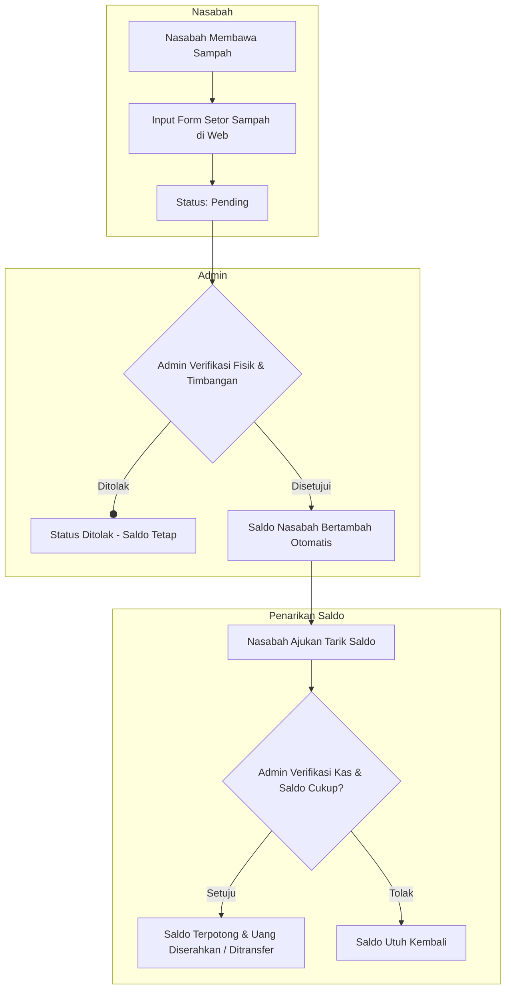

<div align="center">

# ♻️ Bank Sampah Desa Winduherang (v2)

**Sistem Informasi Manajemen Bank Sampah Berbasis Web Menggunakan Laravel 12 & SQLite/MySQL**

Platform digital modern untuk mengelola transaksi penyetoran sampah daur ulang, tabungan saldo nasabah, kategorisasi sampah, hingga rekapitulasi laporan resmi kas bank sampah desa.

---

[](https://laravel.com)
[](https://php.net)
[](https://getbootstrap.com)
[](https://sqlite.org)
[](#-keamanan-aplikasi-security-hardened)
[](LICENSE)

</div>

---

## 📋 Daftar Isi
1. [Tentang Aplikasi](#-tentang-aplikasi)
2. [Fitur Utama](#-fitur-utama)
3. [Alur Transaksi & Bisnis](#-alur-transaksi--bisnis)
4. [Struktur MVC & Arsitektur](#-struktur-mvc--arsitektur)
5. [Keamanan Aplikasi (Security Hardened)](#-keamanan-aplikasi-security-hardened)
6. [Teknologi yang Digunakan](#-teknologi-yang-digunakan)
7. [Panduan Instalasi & Menjalankan](#-panduan-instalasi--menjalankan)
8. [Akun Demo Bawaan](#-akun-demo-bawaan)
9. [Lisensi & Kontribusi](#-lisensi)

---

## 🌟 Tentang Aplikasi

**Bank Sampah v2** adalah solusi digital ramah lingkungan yang dirancang untuk mempermudah operasional Bank Sampah Desa Winduherang. Melalui sistem ini:
* **Warga (Nasabah)** dapat mengonversi sampah daur ulang menjadi saldo tabungan riil, mengajukan penarikan dana ke rekening/e-wallet/tunai, serta memantau riwayat transaksi secara real-time.
* **Pengurus (Admin)** dapat mengelola master harga kategori sampah, memverifikasi pengajuan setoran dan penarikan secara akurat, mengelola data nasabah, serta mencetak laporan rekapitulasi kas resmi desa.

---

## ⚡ Fitur Utama

### 👥 1. Portal Nasabah (Warga)
* **Autentikasi & Registrasi Mandiri:** Pendaftaran akun nasabah baru yang aman dengan validasi data diri dan alamat lengkap.
* **Dashboard Interaktif:** Menampilkan informasi saldo aktif kas nasabah, estimasi nilai sampah, dan kartu aksi cepat.
* **Pengajuan Setor Sampah:** Formulir setor sampah dengan kalkulasi otomatis (berat × harga per kg kategori).
* **Pengajuan Tarik Saldo:** Penarikan saldo kas fleksibel (Tunai, Transfer Bank, atau E-Wallet) dengan sistem proteksi *anti-overdraft*.
* **Riwayat Mutasi Transaksi:** Filter data riwayat (Semua, Mingguan, Bulanan) untuk setoran sampah dan penarikan uang.
* **Notifikasi Lonceng:** Pemberitahuan status pengajuan (*Pending*, *Disetujui*, atau *Ditolak*) secara real-time.

### 🛡️ 2. Portal Administrator
* **Dashboard Statistik:** Ringkasan total nasabah terdaftar, akumulasi berat sampah terkumpul, total kas beredar, serta grafik distribusi sampah per kategori.
* **Manajemen Pengajuan Transaksi:** Antarmuka verifikasi satu klik untuk menyetujui atau menolak permohonan setoran dan penarikan nasabah secara atomik.
* **Manajemen Kategori Sampah (CRUD):** Tambah, ubah nama/harga per kilogram, serta penghapusan kategori dengan proteksi integritas data relasi.
* **Manajemen Data Nasabah:** Pendaftaran, pembaruan biodata, serta penghapusan akun nasabah yang aman.
* **Cetak Laporan Resmi:** Rekapitulasi laporan kas lengkap dengan Kop Surat Resmi Pemerintah Desa Winduherang yang siap cetak / simpan ke PDF.

---

## 🔄 Alur Transaksi & Bisnis



---

## 🏛️ Struktur MVC & Arsitektur

Aplikasi ini dibangun menggunakan arsitektur **Model-View-Controller (MVC)** standar Laravel:

```text
web-bank-sampah/
├── app/
│   ├── Http/
│   │   ├── Controllers/
│   │   │   ├── AdminController.php       # Logika admin (dashboard, acc/tolak, laporan)
│   │   │   ├── AuthController.php        # Otentikasi login, register, logout
│   │   │   ├── DashboardController.php   # Dashboard & mutasi riwayat nasabah
│   │   │   ├── KategoriController.php    # CRUD kategori sampah & tarif per kg
│   │   │   ├── TarikController.php       # Logika pengajuan tarik saldo
│   │   │   └── TransaksiController.php   # Logika pengajuan setor sampah
│   │   └── Middleware/
│   │       └── IsAdmin.php               # Guard otorisasi hak akses admin
│   └── Models/
│       ├── User.php                      # Model data akun & autentikasi
│       ├── Nasabah.php                   # Model data profil warga & total saldo
│       ├── Kategori.php                  # Model jenis sampah & harga per kg
│       ├── TransaksiSetor.php            # Model transaksi setoran sampah
│       └── TransaksiTarik.php            # Model transaksi penarikan saldo kas
├── database/
│   ├── migrations/                       # Skema tabel database lengkap
│   └── seeders/                          # Data inisialisasi awal (admin & kategori)
├── resources/
│   └── views/
│       ├── admin/                        # Tampilan panel admin & cetak laporan
│       ├── auth/                         # Tampilan login & pendaftaran
│       ├── layouts/                      # Layout induk (navbar, toast, sidebar)
│       ├── tarik/                        # Form tarik saldo
│       ├── transaksi/                    # Form setor sampah
│       ├── dashboard.blade.php           # Tampilan dashboard nasabah
│       └── riwayat.blade.php             # Tampilan mutasi transaksi nasabah
└── routes/
    └── web.php                           # Definisi rute URL aplikasi
```

---

## 🔒 Keamanan Aplikasi (Security Hardened)

Aplikasi telah melewati audit keamanan kode (*Application Security Assessment*) dan dilengkapi mekanisme proteksi:
1. **Pencegahan Saldo Negatif & Double Spending:** Persetujuan penarikan menggunakan transaksi database atomik (`DB::beginTransaction`) dan penguncian baris (`lockForUpdate`) untuk mencegah eksploitasi *race condition*.
2. **Validasi Saldo Pending:** Pengajuan penarikan dana menghitung antrean penarikan yang masih *pending* untuk mencegah pengajuan melebihi saldo aktif.
3. **Validasi Input Ketat:** Pembatasan tipe data, rentang angka wajar, dan integritas relasi foreign key pada form setoran sampah dan manajemen kategori.
4. **Pencegahan Brute Force:** Pembatasan laju permintaan (*Rate Limiting*) pada rute `/login` (maksimal 5 percobaan/menit) dan `/register`.
5. **Sanitasi XSS & Blade Escaping:** Sanitasi seluruh pesan alert notifikasi SweetAlert2 menggunakan `json_encode` aman.
6. **Perlindungan CSRF & Bcrypt Hashing:** Seluruh form dilindungi token CSRF dan kata sandi di-hash dengan algoritma Bcrypt standar industri.

---

## 💻 Teknologi yang Digunakan

* **Backend:** [PHP 8.2+](https://php.net), [Laravel 12 Framework](https://laravel.com)
* **Frontend:** Blade Templating, [Bootstrap 5](https://getbootstrap.com), [Bootstrap Icons](https://icons.getbootstrap.com), [SweetAlert2](https://sweetalert2.github.io)
* **Visualisasi Data:** [Chart.js](https://www.chartjs.org) (Statistik Sampah per Kategori)
* **Database:** [SQLite](https://sqlite.org) (Default) / Mendukung [MySQL](https://mysql.com) & [MariaDB](https://mariadb.org)
* **Build Tool:** [Vite](https://vitejs.dev)

---

## 🚀 Panduan Instalasi & Menjalankan

Ikuti langkah-langkah berikut untuk menjalankan proyek ini di komputer lokal:

### 1. Prasyarat Sistem
* PHP >= 8.2 (dengan ekstensi `pdo`, `pdo_sqlite` atau `pdo_mysql`, `mbstring`, `openssl`)
* [Composer](https://getcomposer.org/) terpasang
* XAMPP / Laragon / Web server lokal

### 2. Kloning Repository
```bash
git clone https://github.com/starkoyyy/web-bank-sampah.git
cd web-bank-sampah
```

### 3. Pasang Dependensi PHP
```bash
composer install
```

### 4. Konfigurasi Environment
Salin file konfigurasi `.env.example` menjadi `.env`:
```bash
cp .env.example .env
```
*(Di Windows PowerShell: `copy .env.example .env`)*

### 5. Generate Application Key
```bash
php artisan key:generate
```

### 6. Migrasi & Isi Data Awal Database (Seeding)
Secara bawaan, aplikasi menggunakan SQLite lokal di `database/database.sqlite`. Jalankan:
```bash
php artisan migrate --seed
```
> *Catatan: Jika diminta membuat file `database.sqlite`, pilih **Yes**.*

### 7. Jalankan Server Lokal
```bash
php artisan serve
```
Buka browser dan akses aplikasi di: **`http://127.0.0.1:8000`**

---

## 🔑 Akun Demo Bawaan

Setelah menjalankan `php artisan migrate --seed`, Anda dapat langsung login menggunakan akun berikut:

| Peran | Username | Password | Akses & Kemampuan |
| :--- | :--- | :--- | :--- |
| **Administrator** | `admin` | `admin123` | Akses penuh dashboard admin, verifikasi transaksi, manajemen kategori, & laporan |
| **Nasabah (Warga)** | `nasabah` | `nasabah123` | Akses dashboard nasabah, cek saldo kas, ajukan setor sampah & tarik saldo |

> Anda juga dapat mendaftarkan akun nasabah baru secara langsung melalui menu **Daftar / Register**.

---

## 📄 Lisensi

Proyek ini dirilis di bawah lisensi [MIT License](LICENSE). Bebas digunakan dan dikembangkan untuk keperluan edukasi maupun pemberdayaan masyarakat.
